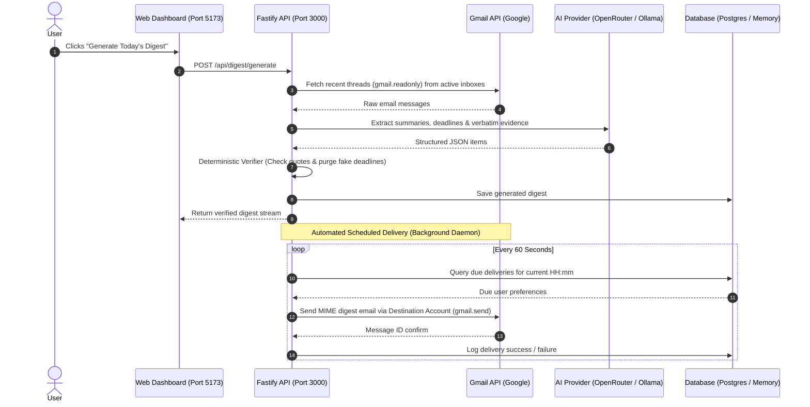

# 📬 GistMyMail — Email Digest Generation & Delivery Guide

GistMyMail turns incoming emails across multiple Gmail accounts into a single, cohesive daily briefing.

This guide explains how to select inboxes, generate digests on-demand, configure automated daily email delivery via Gmail API, and monitor delivery health.

---

## 🔄 End-to-End Delivery Flow



---

## 🎛️ 1. Managing Connected Inboxes

### Ingestion Filtering (Account Selection)
In the **Connected Inboxes** sidebar on the dashboard:
- Each inbox has an **Active Switch / Checkbox**.
- When checked (`isSelectedForDigest: true`), the inbox's unread/recent emails (last 7 days) are included in digest generation.
- When unchecked (`isSelectedForDigest: false`), the inbox is excluded completely from email fetching and digestion.

### Purpose Labels
Assign purpose labels to organize your briefings:
- `College` — Academic announcements, assignments, grades.
- `Business` — Invoices, contracts, investor updates.
- `Clients` — Deliverables, client queries, milestones.
- `Personal` — Family, travel, personal appointments.
- `Newsletter` — Industry updates, tech reads.

Labels are attached to every digest item and rendered with distinct color-coded badges in the briefing.

---

## ⚡ 2. On-Demand Digest Generation

1. On the web dashboard, click the primary **"Generate Today's Digest"** button.
2. The backend:
   - Fetches up to 15 recent messages per selected inbox.
   - Cleans HTML markup and deduplicates repeated messages using SHA-256 content hashes.
   - Dispatches messages to your configured AI provider (`mock`, `openrouter`, or `ollama`).
   - Runs deterministic verification to ensure every deadline is backed by a verbatim quote.
3. The central briefing stream updates immediately.
4. You can filter items by category tabs:
   - **⏰ Deadlines** — Time-sensitive requirements with verified dates.
   - **⚡ Actions** — Actionable items requiring responses or work.
   - **📅 Meetings** — Calendar invitations and events.
   - **⚠️ Needs Clarification** — Items flagged for ambiguity or potential prompt injection attempts.

---

## 📤 3. Authorizing Gmail Sending (`gmail.send`)

To receive your daily digest as an actual email in your primary inbox, GistMyMail uses the official Gmail API send endpoint (`users.messages.send`).

### Read-Only vs Send-Authorized Accounts
When connecting an account via Google OAuth:
- **Base authorization** requests `gmail.readonly`.
- **Send authorization** requests `gmail.send`.

In the **Connected Inboxes** list:
- Accounts with send permission display a green **"Send Authorized"** badge.
- Read-only accounts display a gray **"Read-Only"** badge.

> [!IMPORTANT]
> If your destination account is read-only, GistMyMail displays an alert in the Delivery Settings card:
> *"This inbox is read-only. Connect via OAuth with Send permission to enable automatic email delivery."*

To grant send permission, reconnect the account by clicking **"Connect Real Gmail Account"** and ensuring the checkbox for **"Send email on your behalf"** is checked on Google's consent screen.

---

## 🧪 4. Sending a Test Digest Email

Before setting up daily recurring delivery, verify your email pipeline:

1. In the **Delivery Preferences** panel (right sidebar):
   - Select your **Destination Inbox** from the dropdown.
2. At the top of the dashboard, click **"Send Test Email"**.
3. The backend generates standard MIME `multipart/alternative` email content (both Plain Text and responsive HTML with Tailwind styling).
4. Inspect the top notification banner:
   ```text
   ✓ Test digest email successfully sent to your.email@gmail.com (Gmail ID: 1928374a5b6c7d8e)
   ```
5. Check your Gmail inbox for the incoming digest titled:
   `Your GistMyMail Daily Digest — [Date]`

---

## ⏰ 5. Configuring Daily Scheduled Delivery

Configure your automated briefing schedule under **Delivery Preferences**:

1. **Destination Inbox:** Select the account where your daily briefing should arrive.
2. **Delivery Time (24h):** Set the time you want to receive your digest (e.g., `08:00` for 8:00 AM, `18:30` for 6:30 PM).
3. **Timezone:** Select your timezone:
   - `Asia/Kolkata` (IST - UTC+5:30)
   - `UTC`
   - `America/New_York` (EST)
   - `America/Los_Angeles` (PST)
4. **Scheduled Dispatch Toggle:** Flip the switch to **Enabled**.
5. GistMyMail immediately saves preferences to PostgreSQL (or in-memory store) via `PUT /api/delivery/preferences`.

---

## ⚙️ 6. How the Background Scheduler Works

The scheduling engine is implemented in [`apps/api/src/delivery/scheduler.ts`](file:///apps/api/src/delivery/scheduler.ts):

### Continuous Daemon
- When the backend starts and `SCHEDULER_ENABLED=true` in `.env`, a 60-second timer starts (`setInterval(..., 60000)`).
- Every minute, the scheduler checks the current time in each user's configured timezone and queries the database for due dispatches.

### Duplicate Delivery Prevention
To ensure you never receive duplicate emails if a scheduler tick overlaps:
```typescript
if (pref.lastSuccessAt) {
  const lastSuccess = new Date(pref.lastSuccessAt);
  const diffMinutes = (now.getTime() - lastSuccess.getTime()) / (1000 * 60);
  if (diffMinutes < 55) {
    continue; // Already sent for this delivery slot today
  }
}
```
The scheduler enforces a strict **55-minute cooldown** window per delivery slot.

### Audit Logging & Feedback
Every dispatch attempt is recorded in the `delivery_logs` table with:
- Timestamp of attempt
- Destination email
- Status (`success` or `failed`)
- Google Gmail Message ID (on success)
- Detailed error message (on failure)

The web dashboard displays real feedback directly:
- **Last Successful Delivery:** `✓ Last sent: 10/25/2026, 8:00:15 AM`
- **Delivery Error:** `⚠️ Delivery error: Invalid Credentials / Token Expired`

---

## 🛠️ Delivery Troubleshooting

| Issue | Cause | Solution |
|---|---|---|
| **"Failed to send email: Insufficient Permission"** | The destination account does not have `gmail.send` scope. | Reconnect the account via Google OAuth and check the box to allow sending email. |
| **"No destination account selected"** | Delivery is enabled, but no inbox was selected in the dropdown. | Select a connected inbox in the **Destination Inbox** picker under Delivery Preferences. |
| **Scheduled email did not send at 08:00** | Backend process was not running, or server timezone differed. | Ensure the Fastify backend runs continuously (e.g. via PM2 or systemd). Verify that `DEFAULT_TIMEZONE` in `.env` matches your local timezone. |
| **Digest received in spam / promotions folder** | Gmail filter routed self-sent email to Categories. | Create a Gmail filter for `Subject: Your GistMyMail Daily Digest` to "Never send to Spam" and "Categorize as: Primary". |
